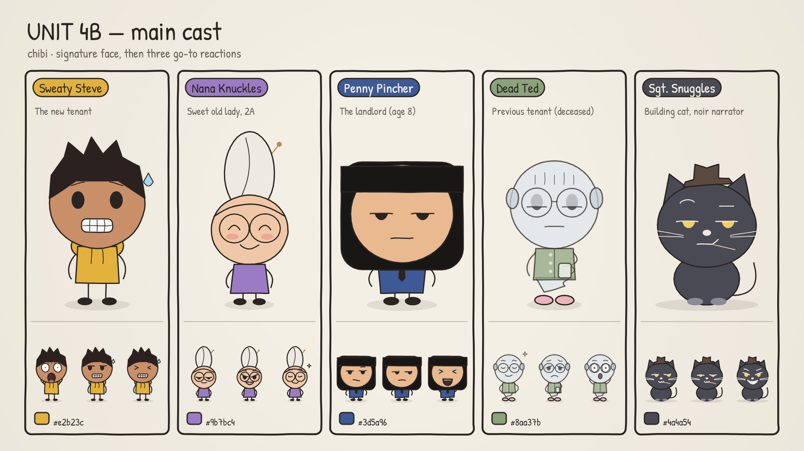

# UNIT 4B — Deadpan Strip

An animated dark-comedy shorts series for an international audience, built as a custom style for the
[Lemo-Opuscar](https://github.com/lemomo-ai/lemo-opuscar) Claude Code skill. Every frame is drawn in code
(Canvas 2D), every voice comes from ElevenLabs.

**Premise.** Sweaty Steve moves into apartment 4B and slowly realises he is the only normal person in the
building. The landlord is eight, the previous tenant never left (he died in 1987), the sweet old lady
downstairs is clearly a retired *something*, and the building cat narrates everything like a film noir.

| Character | Role | The name is the joke |
|---|---|---|
| **Sweaty Steve** | the new tenant, the straight man | always sweating |
| **Nana Knuckles** | sweet old lady in 2A, implied retired assassin | "Nana" is soft, "Knuckles" is not |
| **Penny Pincher** | the landlord, age 8 | the stingiest landlord alive |
| **Dead Ted** | previous tenant (deceased, 1987) | he is dead, and it rhymes |
| **Sgt. Snuggles** | building cat, noir narrator | a hard-boiled detective called Snuggles |



## What's inside

```
styles/deadpan-strip/        the Lemo-Opuscar style
  STYLE.md                   look, motion, camera, sound, rules (11 fixed sections)
  CAST.md                    characters, looks, personalities, voices
  JOKES.md                   joke formats for shorts, face/voice pairings, 7 sample scripts
  ELEVENLABS.md              voice setup and delivery tables (Vietnamese)
  elevenlabs.json            voice IDs, 36 deliveries per character, 180 audition lines
  voices.json                Kokoro settings (free offline fallback)
  demo/cast.js               drawing engine: 5 chibi characters x 26 expressions
  demo/elevenlabs_tts.py     ElevenLabs voice generator (drop-in for core/tts/tts.py)
  demo/render_expr.mjs       renders an expression sheet for one character
  expressions/               26-expression sheets for every character
  voice-samples/elevenlabs/  180 ready-made ElevenLabs clips (36 deliveries x 5 characters)
bible/index.html             interactive series bible: every face, every voice, scripts
episodes/                    written episodes (script.md + lines.json [+ voice/]) and BANK.md of used jokes
.claude/skills/unit4b-joke-lab/   Claude Code skill: research topics and write scored jokes for the cast
tools/viral_research.py      find viral shorts, pull their subtitles, check a script for copied lines
research/                    DNA cards from viral research (raw transcripts are git-ignored)
```

## 1. Install Lemo-Opuscar

```bash
claude plugin marketplace add lemomo-ai/lemo-opuscar
claude plugin install lemo-opuscar@lemolab
```

On first use the skill downloads its library to `~/lemo-opuscar`. Requirements: Node 20+, ffmpeg, Python 3.11+.

## 2. Add the style

```bash
git clone https://github.com/<you>/<this-repo>.git unit4b
cp -r unit4b/styles/deadpan-strip ~/lemo-opuscar/styles/
```

(If you work from a clone of lemo-opuscar instead, copy it into that clone's `styles/` folder.)
Keep this repo as the source of truth and copy again after you change the style.

## 3. Set up voices

```bash
export ELEVENLABS_API_KEY=...        # never commit it; see .env.example
```

The voice IDs in `elevenlabs.json` live in the original ElevenLabs account. On another account, create
the five voices with Voice Design using each character's `design_prompt`, then paste the new IDs into
`voice_id`. Details: `styles/deadpan-strip/ELEVENLABS.md`.

## 4. Make an episode

Open Claude Code in an empty folder and ask, for example:

> Make a 25-second 9:16 short in the **deadpan-strip** style: episode 07 "For the Boos" from JOKES.md.
> Use the cast in demo/cast.js and generate the voices with demo/elevenlabs_tts.py.

The skill asks once whether you want a storyboard first, then directs, draws, voices, scores and renders
the film into that folder.

### Writing dialogue

A lines file is a JSON list. One field, `expr`, drives both the face in the animation and the delivery:

```json
[
 {"id": "s01_ted",   "char": "ted",   "expr": "proud",   "text": "Why did the ghost go to the party?", "tail": ""},
 {"id": "s02_steve", "char": "steve", "expr": "cringe",  "text": "Please don't."},
 {"id": "s03_ted",   "char": "ted",   "expr": "proud",   "text": "For the boos."},
 {"id": "s04_penny", "char": "penny", "expr": "deadpan", "text": "No."}
]
```

- `char`: `steve` · `nana` · `penny` · `ted` · `snuggles`
- `expr`: one of 26 faces (`neutral`, `deadpan`, `side_eye`, `smug`, `skeptical`, `happy`, `grin`, `laughing`,
  `proud`, `shocked`, `horrified`, `nervous`, `awkward`, `embarrassed`, `confused`, `sad`, `crying`, `angry`,
  `furious`, `disgusted`, `evil`, `dead_inside`, `sleepy`, `cringe`, `dizzy`, `knocked_out`) or one of 10
  sarcasm styles (`sarcastic`, `mock_excited`, `fake_sweet`, `condescending`, `eye_roll`, `mock_sympathy`,
  `slow_clap`, `passive_aggressive`, `mocking_mimic`, `fake_gasp`), which carry their own face.
- `mode` (optional): a named delivery such as `dad_joke` or `deadpan_threat`; wins over `expr` for the voice.

```bash
cd ~/lemo-opuscar/styles/deadpan-strip
python demo/elevenlabs_tts.py lines.json out/voice --fx          # generate the voices
python demo/elevenlabs_tts.py lines.json out/voice --dry-run     # preview requests, no credits
python demo/elevenlabs_tts.py --audition-expr ted out/ted        # hear all 36 deliveries of one character
```

Output matches Lemo-Opuscar's own TTS step: `out/voice/<id>.wav`, `dur.json`, plus `captions.json` for subtitles.

## 5. Write new jokes with the Joke Lab skill

The repo ships a Claude Code skill, `unit4b-joke-lab`. Open Claude Code **in this repo** and it is
available automatically (to use it everywhere, copy `.claude/skills/unit4b-joke-lab` to `~/.claude/skills/`).

Ask in plain words, for example:

> Give me 5 joke ideas for this week.

> Write the next episode about something people are annoyed about right now.

> Write 3 episodes with Nana and Penny, sarcastic, 25 seconds each.

The skill:
1. researches current and evergreen relatable topics (web search; trend and community sources in `references/research.md`),
2. drops anything that wouldn't survive subtitles or that punches down,
3. matches each topic to the character whose comic engine fits it,
4. writes several premises and 5+ alternative punchlines each, scores them with `references/scorecard.md` (keeps ≥ 32/40),
5. writes the short (hook, punchline timing, silent beat, button) with an `expr` for every line,
6. saves `episodes/NN-slug/script.md` and `lines.json`, adds the joke to `episodes/BANK.md` so it is never reused,
7. validates `lines.json` against the voice config with a dry run.

### Learn from viral shorts

The skill can study viral comedy shorts by reading their subtitles, then write **original** jokes with the
same mechanics (hook type, punch timing, joke mechanism). Install the tools once:

```bash
pip install yt-dlp youtube-transcript-api
```

Then just ask, for example:

> Học từ 10 video viral về chủ nhà rồi viết 3 tập tương tự cho Penny.

> Analyze these shorts and propose jokes for our cast: <url> <url> <url>

Or run the tool yourself:

```bash
python tools/viral_research.py find --search "landlord animated comedy" --shorts-only --out research/viral/landlords
python tools/viral_research.py subs --from research/viral/landlords/candidates.json --top 10
python tools/viral_research.py check episodes/09-slug/lines.json research/viral/landlords/transcripts
```

The skill writes one DNA card per video (pain point, hook, setup length, punch position, mechanism, why it
spreads) and a Patterns summary, and only borrows mechanisms: situations, lines and characters are always new,
and `check` fails any script that shares five consecutive words with a source. If YouTube asks you to sign in,
add `--cookies-from-browser chrome` before the subcommand.

Then generate the voices and render:

```bash
cd styles/deadpan-strip
python demo/elevenlabs_tts.py ../../episodes/08-repair-plus/lines.json ../../episodes/08-repair-plus/voice --fx
```

> Make this short in the deadpan-strip style from episodes/08-repair-plus/script.md.

Episode 08 "Repair Plus" is a worked example made by the skill, with its voices already generated.

## 6. The series bible

Open `bible/index.html` in a browser (or turn on GitHub Pages for this repo) to see every character,
click through all 36 faces and voices, and read the joke playbook and sample scripts.

## Notes

- Style built for Lemo-Opuscar; tuned for Claude Opus models like the original styles.
- ElevenLabs does not allow child voices, so Penny is voiced the way animation usually does it: an adult
  performer in a cartoon register.
- Original characters and designs. The tone takes its grammar from dark-humour webcomics, not any artist's
  characters or look.
